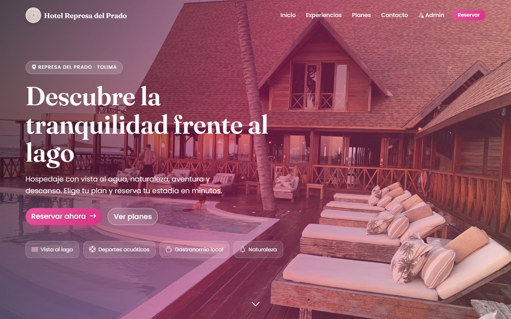
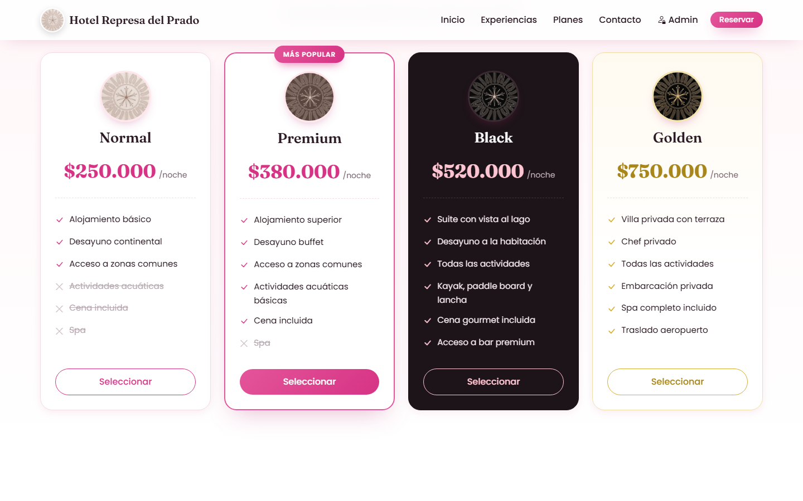
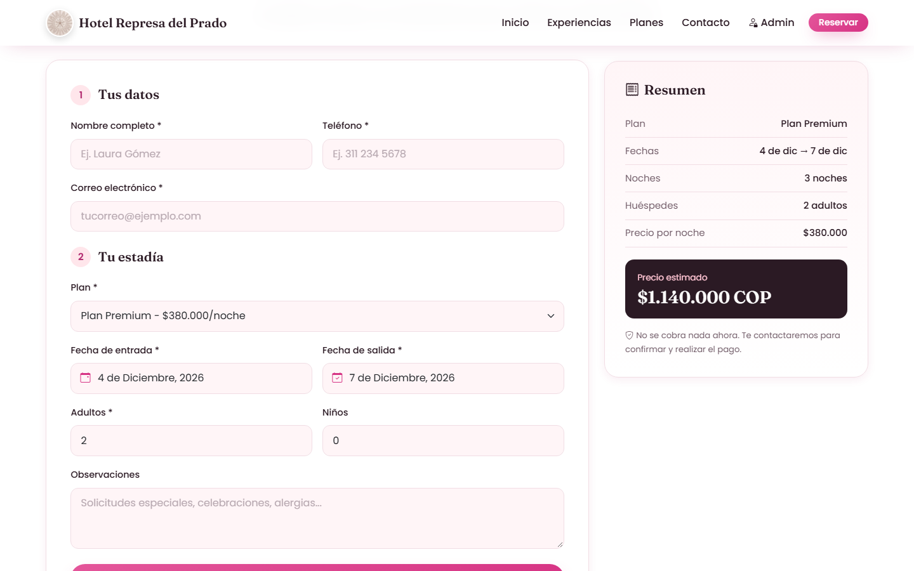
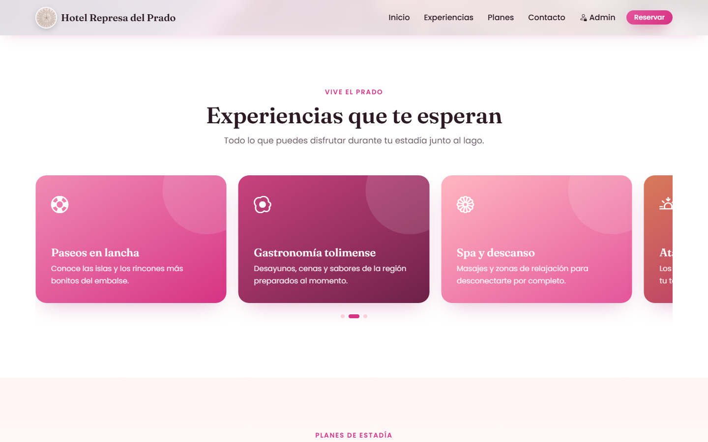
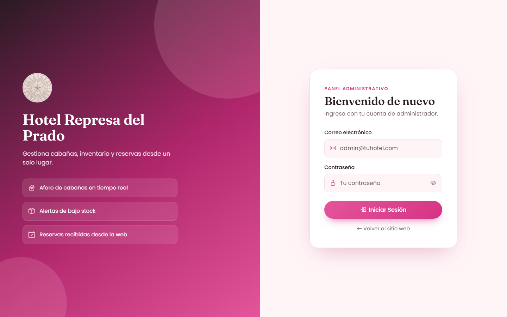
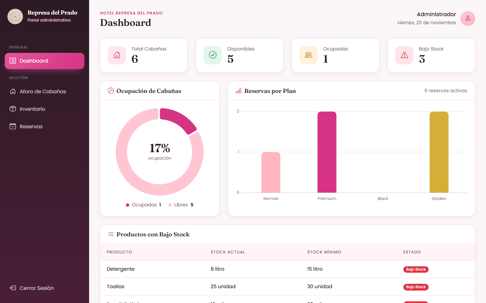

<div align="center">


# Hotel Represa del Prado · Sistema de Reservas

Sitio web y panel administrativo para un hotel junto a la **Represa del Prado (Tolima, Colombia)**.
Los huéspedes eligen un plan y reservan en línea; el equipo del hotel gestiona cabañas, inventario y reservas desde un panel con gráficas.


</div>



## Tabla de contenido

- [Características](#características)
- [Capturas](#capturas)
- [Tecnologías](#tecnologías)
- [Estructura del proyecto](#estructura-del-proyecto)
- [Instalación](#instalación)
- [Variables de entorno](#variables-de-entorno)
- [API](#api)
- [Autor](#autor)

## Características

### Sitio público
- Portada a pantalla completa con navegación que cambia de estilo al hacer scroll.
- Carrusel de experiencias (kayak, lancha, gastronomía, spa y atardeceres).
- **4 planes de estadía**: Normal, Premium, Black y Golden.
- Formulario de reserva con calendario en español, validación de fechas y **resumen con el precio calculado en vivo**.
- Las reservas se guardan en MongoDB y quedan pendientes de confirmación.
- Diseño responsive y animaciones suaves al hacer scroll.

### Panel administrativo
- Inicio de sesión protegido con **JWT** y contraseñas cifradas con **bcrypt**.
- Dashboard con cifras clave y gráficas de **ocupación de cabañas** y **reservas por plan**.
- Aforo de cabañas: crear cabañas y cambiar su estado (disponible, ocupada, mantenimiento, limpieza).
- Inventario con alertas de **bajo stock**.
- Listado de reservas recibidas desde la web.

## Planes

| Plan | Precio por noche | Incluye |
|------|-----------------:|---------|
| **Normal** | $250.000 COP | Alojamiento básico, desayuno continental, zonas comunes |
| **Premium** | $380.000 COP | Alojamiento superior, desayuno buffet, actividades acuáticas básicas, cena |
| **Black** | $520.000 COP | Suite con vista al lago, desayuno a la habitación, todas las actividades, lancha, bar premium |
| **Golden** | $750.000 COP | Villa privada, chef privado, embarcación privada, spa completo, traslado al aeropuerto |

## Capturas

| Planes | Reserva con resumen en vivo |
|:---:|:---:|
|  |  |
| **Experiencias** | **Inicio de sesión** |
|  |  |

**Panel administrativo**



## Tecnologías

| Capa | Tecnologías |
|------|-------------|
| Frontend | HTML5, CSS3, JavaScript, Bootstrap 5.3, Bootstrap Icons |
| Librerías de interfaz | AOS (animaciones), Flatpickr (calendario), Swiper (carrusel), Chart.js (gráficas) |
| Tipografía | Fraunces y Poppins (Google Fonts) |
| Backend | Node.js, Express |
| Base de datos | MongoDB Atlas con Mongoose |
| Seguridad | JSON Web Tokens, bcryptjs, variables de entorno con dotenv |

Las librerías del frontend se cargan desde CDN, así que el frontend no necesita instalación.

## Estructura del proyecto

```
HotelRepresaDelPrado/
├── index.html              # Sitio público
├── css/style.css           # Estilos del sitio
├── js/app.js               # Reservas, calendario, carrusel y animaciones
├── img/                    # Logos de los planes
├── admin/
│   ├── login.html          # Inicio de sesión
│   ├── dashboard.html      # Panel administrativo
│   ├── css/                # Estilos del panel
│   └── js/                 # Lógica del login y del panel
├── backend/
│   ├── server.js           # Servidor Express (API + archivos del sitio)
│   ├── config/db.js        # Conexión a MongoDB
│   ├── middleware/         # Autenticación JWT y rol de administrador
│   ├── models/             # Cabana, Inventario, Reserva, Usuario
│   ├── routes/             # Rutas de la API
│   ├── seed/               # Datos iniciales y usuario administrador
│   └── .env.example        # Plantilla de variables de entorno
└── docs/capturas/          # Imágenes de este README
```

## Instalación

**Requisitos:** [Node.js](https://nodejs.org/) 18 o superior y una base de datos MongoDB (por ejemplo, un clúster gratuito de [MongoDB Atlas](https://www.mongodb.com/atlas)).

1. **Clona el repositorio**
   ```bash
   git clone https://github.com/angelarenalesdev/hotel-represa-del-prado.git
   cd hotel-represa-del-prado/backend
   ```

2. **Instala las dependencias**
   ```bash
   npm install
   ```

3. **Configura las variables de entorno**: copia `.env.example` como `.env` y completa tus datos (ver la sección siguiente).

4. **Carga los datos iniciales** (cabañas e inventario) y crea el usuario administrador
   ```bash
   npm run seed:datos
   npm run seed:admin
   ```

5. **Inicia el servidor**
   ```bash
   npm start        # o "npm run dev" para reiniciar automáticamente al guardar
   ```

6. Abre en el navegador:
   - Sitio público: http://localhost:5000
   - Panel administrativo: http://localhost:5000/admin/login.html

## Variables de entorno

Se definen en `backend/.env` (este archivo **no** se sube al repositorio):

| Variable | Descripción |
|----------|-------------|
| `PORT` | Puerto del servidor (por defecto `5000`) |
| `MONGODB_URI` | Cadena de conexión de MongoDB |
| `JWT_SECRET` | Clave secreta para firmar los tokens |
| `NODE_ENV` | `development` o `production` |
| `ADMIN_EMAIL` | Correo del administrador que crea `npm run seed:admin` |
| `ADMIN_PASSWORD` | Contraseña de ese administrador |

## API

| Método | Ruta | Acceso | Descripción |
|--------|------|--------|-------------|
| `POST` | `/api/auth/login` | Público | Inicia sesión y devuelve un token |
| `GET` | `/api/auth/perfil` | Usuario | Datos del usuario autenticado |
| `POST` | `/api/reservas` | Público | Crea una reserva desde el sitio web |
| `GET` | `/api/reservas` | Admin | Lista las reservas |
| `GET` | `/api/reservas/dashboard/resumen` | Admin | Resumen de reservas |
| `GET` | `/api/cabanas` | Usuario | Lista las cabañas |
| `GET` | `/api/cabanas/dashboard/aforo` | Admin | Ocupación de cabañas |
| `POST` | `/api/cabanas` | Admin | Crea una cabaña |
| `PUT` | `/api/cabanas/:id/estado` | Admin | Cambia el estado de una cabaña |
| `GET` | `/api/inventario` | Usuario | Lista el inventario |
| `GET` | `/api/inventario/dashboard/inventario` | Admin | Productos con bajo stock |
| `POST` | `/api/inventario` | Admin | Agrega un producto |
| `PUT` | `/api/inventario/:id/stock` | Admin | Actualiza el stock |

Las rutas protegidas requieren el encabezado `Authorization: Bearer <token>`.

## Autor

**Angel Arenales**
